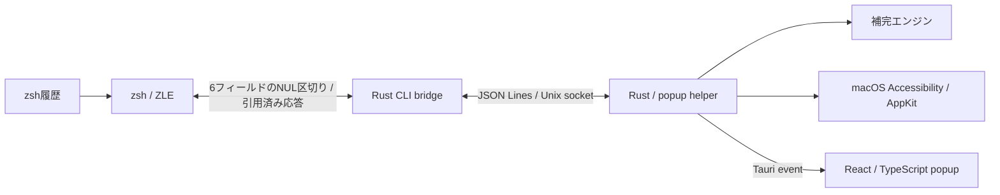

# アーキテクチャと通信契約

## 責務

- core：実行を伴わないリテラルの入力解析、候補生成、シェル引用、設定、通信型、更新番号の管理。
- CLI：zsh初期設定、設定ファイルの読み書き、一時停止・再開、権限設定の開始、診断、ヘルパーの自動起動、シェルごとの通信ブリッジ。
- 描画ヘルパー：候補生成の非同期実行、フォーカス・位置情報の検証、ポップアップ表示。設定ウィンドウ・メニューバー・deep linkは持たず、起動時にユーザーへ画面を表示しない。
- frontend：候補と説明の表示。候補挿入はZLEが行い、WebViewへフォーカスを渡さない。

## 補完要求・応答

プロトコルのバージョンは1。外側のメッセージは`type`によるタグ付きJSON、1行1メッセージで最大256 KiB。改行はJSON文字列内でエスケープされる。途中まで受信したフレームは読み取りFutureがキャンセルされても保持する。

`complete`の`request`は`sessionId`、`revision`、`buffer`、`cursor`、`cwd`、`terminalPid`を含む。`cursor`と応答の`replaceStart`／`replaceEnd`は**Unicodeスカラー数**を単位とする0始まりの半開区間。UTF-8バイト数・JavaScriptのUTF-16長として扱わない。

`completion`の`response`には、セッション・更新番号、置換範囲、候補一覧、選択番号、実際にポップアップを表示できたかを示す`visible`を含む。候補には表示名、説明、引用済みの挿入文字列、種別、後置スペースの有無を持つ。

ブリッジは新しい更新番号と一致する応答だけをシェルへ渡す。閉じる操作以降の遅い応答は破棄する。シェルも更新番号を確認し、候補と選択状態を保持してキー操作を即時処理する。入力欄を変更する文字列はデータとして扱い、`eval`を使用しない。

シェル→ブリッジは`operation`、`revision`、`cursor`、`cwd`、`buffer`、`selected`の6フィールドをNULで区切る。ブリッジ→シェルは`R revision start end visible count [quotedInsertion appendSpace]...`。`P historyEnabled`は設定・一時停止を反映する。

## ポップアップの描画

Reactの`Popup`は幅320px・行高20pxの候補一覧と、選択候補の説明を表示する高さ20pxのフッターで構成します。描画ヘルパーの`popup_height()`は上下1pxずつの外枠も含め、`22 + 候補数 × 20`でウィンドウの高さを計算します。余白や行高を変更するときは、CSSとこの計算を同時に更新します。

候補名とアイコンは7種類の配色で区別し、選択行には対応する背景色と左端のマーカーを表示します。`listbox`の`aria-activedescendant`と各候補の`aria-selected`で選択状態を示し、選択候補の`aria-describedby`をフッターの説明へ関連付けます。説明が空なら候補の種類名を使い、ディレクトリは`folder`と表示します。

## 位置・フォーカス

ブリッジ起動時に親プロセス列からTerminal.app／iTerm2のPIDを特定する。アプリはそのPIDと最前面のアプリが一致し、フォーカスされた要素の挿入位置が取得できた場合だけ表示する。

Accessibilityの`AXSelectedTextRange`／`AXBoundsForRange`を使う。0長の範囲を取得できない場合、直前の文字の範囲の右端を使う。AppKitの画面座標へ変換し、画面端ではポップアップを上へ移動する。120msごとに表示中の位置・フォーカスを確認する。

入力位置を提供しないターミナルでウィンドウ位置から推測することはしない。権限不足、別タブ・ペインやアプリへのフォーカス変更、取得エラーでは候補を閉じる。

## ローカルデータとライフサイクル

ソケットはユーザー所有・0700のランタイムディレクトリに作り、ソケット自体は0600。既存の非ソケットを上書きしない。終了時は自分が作ったソケットのinodeが変わっていない場合だけ削除する。

設定は一時ファイルからrenameで置き換える。入力・作業ディレクトリ・履歴をログへ出さない。Gitの読み取りには150msの上限を設定し、パッケージ管理コマンドやスクリプトを補完時に実行しない。

## CLIとヘルパーの管理

`setup`は既存のzsh設定をバックアップして管理用ブロックを追記する。`config`はヘルパーが停止中でも設定ファイルを読み書きできる。稼働中は`reloadSettings`で再読み込みし、全シェルへ`preferences`を通知する。`setPaused`と`requestAccessibility`もUnixソケットを通じて操作する。WebViewに公開するコマンドは候補の読み取りだけとする。

ブリッジはソケットがない場合、CLIと同じ配布物内の描画ヘルパーを独立したプロセスグループで直接起動する。標準入出力は切り離し、設定・ランタイムの環境変数を引き継ぐ。ターミナルを閉じてもヘルパーは稼働できる。macOSのアプリバンドルは権限の識別とポップアップ表示のために内部利用し、ユーザー向けの操作はCLIへ集約する。
