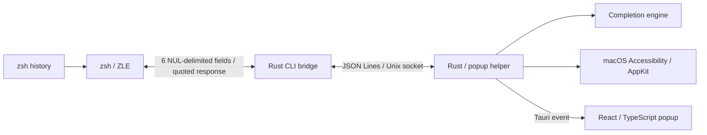

## Responsibilities {#責務}

- The core handles literal input parsing, candidate generation, shell quoting, settings, protocol types, and revision tracking.
- The CLI handles zsh setup, preference files, pause and resume, permission requests, diagnostics, helper startup, and a bridge for each shell.
- The popup helper runs completion work asynchronously, verifies focus and position, and renders suggestions. The CLI controls its lifecycle and configuration.
- The frontend displays candidates and descriptions. ZLE inserts selected text while keyboard focus stays in the terminal.

## Completion requests and responses {#補完要求応答}

Protocol version 1 uses JSON messages tagged by `type`. Each message occupies one line and has a maximum frame size of 256 KiB. Newlines inside JSON strings are escaped. Partial incoming frames survive cancellation of the read future.

A `complete` message contains a `request` with `sessionId`, `revision`, `buffer`, `cursor`, `cwd`, and `terminalPid`. `cursor` and the response's `replaceStart` and `replaceEnd` use **Unicode scalar offsets** in a zero-based, half-open range. UTF-8 byte counts and JavaScript UTF-16 lengths use different units.

A `completion` message contains a `response` with the session, revision, replacement range, candidates, selected index, and a `visible` flag indicating actual native popup visibility. Each candidate includes a label, description, shell-quoted insertion text, kind, and trailing-space flag.

The bridge forwards responses matching the latest revision. Results arriving after dismissal are discarded. The shell also checks revisions and retains candidates and selection state to handle keys immediately. Insertion strings are treated as data and passed through the quoting protocol.

Shell-to-bridge messages contain six NUL-delimited fields in this order.

```text
operation, revision, cursor, cwd, buffer, selected
```

Bridge-to-shell responses use `R revision start end visible count [quotedInsertion appendSpace]...`. Preference messages use `P historyEnabled popupEnabled` and reflect settings and pause state.

## Popup rendering {#ポップアップの描画}

The React `Popup` renders a 320px-wide candidate list with 20px rows and a 20px footer for the selected candidate's description. The helper's `popup_height()` includes the 1px border on each edge and calculates the window height as `22 + candidate count × 20`. Changes to row height or vertical spacing must update both the CSS and this calculation.

Candidate labels and icons use seven type-specific colors. The selected row has a matching tinted background and a left-edge marker. The listbox's `aria-activedescendant` and each candidate's `aria-selected` expose the selection, while the selected candidate's `aria-describedby` references the footer description. If the description is empty, the footer uses the candidate type, showing `folder` for directories.

## Position and focus {#位置フォーカス}

Zed uses an optional palette InputMethodKit helper embedded in the CLI and registered with `figfig setup terminal`. The popup helper requests geometry via a distributed notification. The tracker returns a `cursorPosition` message containing only a request ID, PID, coordinates, line height, and focus identifier through the private Unix socket. It does not handle keystrokes or read text. Replies must match the request ID and PID within 500ms. Position changes close visible suggestions to avoid moving them into another pane or the editor.

At startup, the bridge walks its parent processes to identify the supported terminal/editor main process. The helper shows the popup when that PID matches the foreground application and the focused element exposes its insertion position.

Position lookup uses Accessibility's `AXSelectedTextRange` and `AXBoundsForRange`. If bounds for a zero-length range are unavailable, it uses the right edge of the preceding character. Coordinates are converted to AppKit screen coordinates, and the popup can move above the cursor near the screen edge. Visible position and focus are checked every 120ms.

Cursor placement depends on position information from the terminal. Missing permission, focus changes to another app, tab, or pane, and lookup errors close the popup.

## Local data and lifecycle {#ローカルデータとライフサイクル}

The socket is created in a user-owned runtime directory with mode 0700 and uses mode 0600 itself. Binding rejects an existing path that is a regular file or another non-socket type. Shutdown removes the socket only when its inode still matches the one created by that process.

Settings are replaced atomically by renaming a temporary file. Logs exclude input buffers, working directories, and history. Git reads have a 150ms timeout. Completion reads package-script metadata directly and treats user input as literal data.

## CLI and helper management {#cliとヘルパーの管理}

`setup` backs up existing zsh configuration and appends a managed block. `config` reads and writes settings even while the helper is stopped. A running helper receives `reloadSettings` and broadcasts `preferences` to connected shells. `setPaused` and `requestAccessibility` also use the Unix socket. The WebView's exposed command reads completion state.

If the socket is unavailable, the bridge directly starts the bundled popup helper in its own process group. Standard streams are detached, while runtime and configuration environment variables are inherited. The helper can continue running after a terminal closes. The macOS app bundle supplies permission identity and native popup rendering, and the CLI provides the user-facing controls.

## Editor adapters

`assets/terminal-hosts.json` is the shared registry embedded in Rust and the native cursor tracker. VSCode/Cursor validate the xterm textarea class through Accessibility before positioning the popup. Direct AX geometry is preferred; InputMethodKit is the fallback. JetBrains uses a plugin socket named `jb-<PID>.sock` in the same private runtime directory. Requests contain a request ID and IDE PID; the plugin captures terminal geometry and focus on the EDT, then sends the existing `cursorPosition` message to `app.sock`. It handles no key events or terminal text. It observes only the length of active IME composition to suppress suggestions. A zero-height JediTerm point is normalized using the focused component's font metrics. `coordinateSystem` defaults to `appKit` for existing frames; adapters send `accessibility` for top-left screen points. Both routes retain request-ID/PID/deadline and session-revision checks. Tracked popups close when geometry or terminal focus changes.
